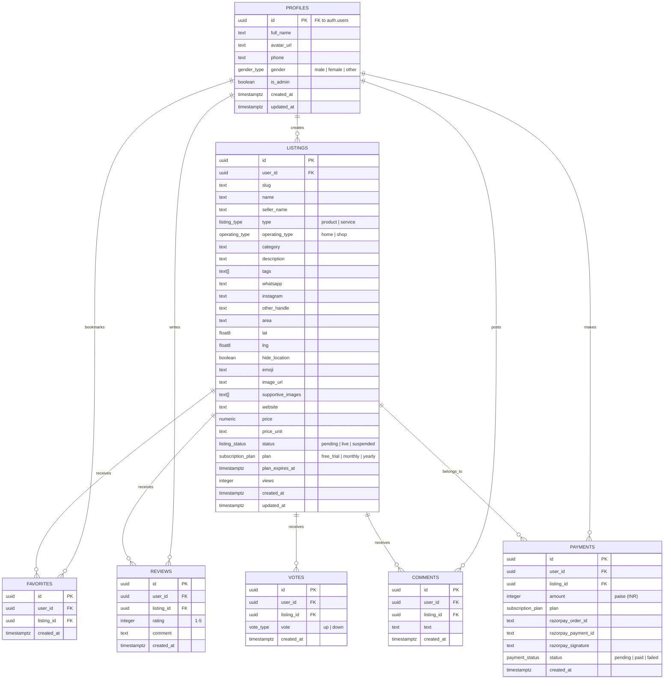

# Aaspass — Database Schema Guide

> Detailed documentation for the PostgreSQL schema running on Supabase.  
> Migration files are in `sqldb/` (run in order: `00_` → `13_`).

---

## Entity Relationship Diagram



---

## Custom Enums (`00_enums.sql`)

| Enum | Values | Usage |
|------|--------|-------|
| `listing_type` | `product`, `service` | What the freelancer offers |
| `listing_status` | `pending`, `live`, `suspended` | Listing lifecycle |
| `operating_type` | `home`, `shop` | Physical presence type |
| `subscription_plan` | `free_trial`, `monthly`, `yearly` | Pricing plans |
| `payment_status` | `pending`, `paid`, `failed` | Razorpay transaction state |
| `gender_type` | `male`, `female`, `other` | User gender |
| `vote_type` | `up`, `down` | Community voting |

---

## Tables

### profiles (`01_profiles.sql`)
Mirrors `auth.users`. Auto-created by a trigger on user signup.

| Column | Type | Notes |
|--------|------|-------|
| `id` | `uuid` PK | Same as `auth.users.id` |
| `full_name` | `text` | Display name |
| `avatar_url` | `text` | Cloudinary URL |
| `phone` | `text` | Optional phone number |
| `gender` | `gender_type` | Optional |
| `is_admin` | `boolean` | Default `false` |

### listings (`02_listings.sql`)
Core table — products and services posted by freelancers.

| Column | Type | Notes |
|--------|------|-------|
| `id` | `uuid` PK | Auto-generated |
| `user_id` | `uuid` FK | → `auth.users.id` |
| `slug` | `text` UNIQUE | URL-friendly name |
| `name` | `text` | Listing title |
| `type` | `listing_type` | Product or Service |
| `category` | `text` | Skill category |
| `lat` / `lng` | `float8` | GPS coordinates |
| `area` | `text` | Human-readable location |
| `image_url` | `text` | Main image (Cloudinary) |
| `status` | `listing_status` | Default `pending` |
| `plan` | `subscription_plan` | Default `free_trial` |
| `views` | `integer` | Default `0` |

### favorites (`03_favorites.sql`)
User ↔ Listing bookmarks. Unique constraint on `(user_id, listing_id)`.

### reviews (`04_reviews.sql`)
Star ratings (1–5) with optional text. One review per user per listing.

### comments (`05_comments.sql`)
Free-form discussion threads on listings.

### votes (`06_votes.sql`)
Up/down votes. One vote per user per listing (can change direction).

### payments (`07_payments.sql`)
Razorpay transaction log. Amount stored in **paise** (₹100 = 10000 paise).

---

## Key Indexes (`08_indexes.sql`)

| Index | Type | Purpose |
|-------|------|---------|
| `listings_location_idx` | B-tree (`lat`, `lng`) | Spatial queries |
| `listings_search_idx` | GIN (`tsvector`) | Full-text search |
| `listings_user_status_idx` | Composite | "My listings" queries |
| `listings_category_idx` | B-tree | Category filtering |
| `favorites_unique_idx` | UNIQUE | Prevent duplicate bookmarks |
| `reviews_user_listing_idx` | UNIQUE | One review per user per listing |
| `votes_user_listing_idx` | UNIQUE | One vote per user per listing |

---

## RLS Policies (`09_rls_policies.sql`)

All tables have RLS enabled. The anon key cannot bypass these policies.

### profiles
- **SELECT**: Users can read their own profile
- **UPDATE**: Users can update their own profile
- Admin can read all profiles

### listings
- **SELECT**: Anyone can read `live` listings. Users can read their own (any status).
- **INSERT**: Authenticated users only
- **UPDATE**: Only the listing owner
- **DELETE**: Only the listing owner

### favorites
- **SELECT / DELETE**: Own favorites only
- **INSERT**: Authenticated users

### reviews
- **SELECT**: Public (all reviews visible)
- **INSERT**: Authenticated users
- **UPDATE / DELETE**: Own reviews only

---

## Functions (`10_functions.sql`)

### `get_listings_nearby(user_lat, user_lng, radius_km)`
Returns live listings within radius, sorted by Haversine distance.

### `search_listings(query)`
Full-text search using `to_tsvector('english', name || description || tags)`.

### `toggle_favorite(p_listing_id)`
Atomic insert-or-delete. Returns `true` if added, `false` if removed.

### `activate_listing(p_listing_id, p_plan, p_payment_id)`
Sets listing status to `live`, records plan, and calculates expiry date.

### `increment_listing_views(p_listing_id)`
Increments the `views` counter atomically.

---

## Triggers (`11_triggers.sql`)

| Trigger | Table | Event | Action |
|---------|-------|-------|--------|
| `on_auth_user_created` | `auth.users` | INSERT | Auto-create `profiles` row |
| `update_updated_at` | `listings`, `profiles` | UPDATE | Set `updated_at = now()` |

---

## Migration Checklist

To set up the database from scratch:

```bash
# In Supabase SQL Editor, run in this exact order:
sqldb/00_enums.sql
sqldb/01_profiles.sql
sqldb/02_listings.sql
sqldb/03_favorites.sql
sqldb/04_reviews.sql
sqldb/05_comments.sql
sqldb/06_votes.sql
sqldb/07_payments.sql
sqldb/08_indexes.sql
sqldb/09_rls_policies.sql
sqldb/10_functions.sql
sqldb/11_triggers.sql
sqldb/13_admin_setup.sql

# Then generate TypeScript types:
npx supabase gen types typescript --project-id YOUR_ID > src/lib/db-types.ts
```

> **Note**: `12_storage_policies.sql` is NOT needed — images use Cloudinary.
